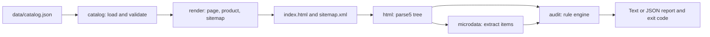

# Architecture

## Overview

Proseo is a static site with a build-time toolchain. All logic runs at build or audit time, and the page itself uses only HTML, CSS, and SVG. GitHub Pages publishes the repository root, so the other tracked files are also reachable as static files, but the page does not load them. With no server code, a `frontend/` and `backend/` split would add structure without separating anything.



## Module structure

```text
.
|-- index.html                 Generated page, served by GitHub Pages
|-- sitemap.xml                Generated sitemap
|-- assets/
|   |-- css/site.css           Layered, nested CSS with light and dark themes
|   `-- images/                Project-owned SVG illustrations
|-- bin/proseo.mjs             CLI entry point
|-- data/catalog.json          Source of truth for page content
|-- db/schema.sql              Optional SQLite audit history
|-- scripts/                   Test report generation
|-- src/
|   |-- audit/
|   |   |-- engine.mjs         Runs rules and summarizes findings
|   |   |-- finding.mjs        Finding factory
|   |   `-- rules/             document, links, media, microdata, security
|   |-- catalog/               Loading and validation
|   |-- cli/main.mjs           Argument parsing, dispatch, exit codes
|   |-- html/                  Escaping and parse-tree helpers
|   |-- microdata/extract.mjs  HTML microdata item extraction
|   `-- render/                Page, product, sitemap, artifact writing
|-- tests/
|   |-- helpers/
|   |-- integration/           CLI, published site, SQL schema
|   `-- unit/
`-- reports/tests/             Recorded test run
```

## Dependency direction

`cli` depends on `audit`, `render`, `catalog`, `microdata`, and `html`. `audit` depends on `microdata` and `html`. `render` depends on `catalog` and `html`. `microdata` depends on `html`. `html` depends only on parse5. Rules do not import each other, except that `security` reuses the URL normalizer from `links`.

## Key decisions

| Decision | Reason |
| --- | --- |
| Generated `index.html` stays at the root | GitHub Pages serves this repository from the `master` root |
| Artifacts are committed and checked | Pages needs no build step, and `build --check` prevents drift |
| Real HTML parser (parse5) | Regular expressions cannot parse HTML reliably, especially hostile input |
| Iterative tree walks, a depth limit, and extraction budgets | Deeply nested or repetitive input cannot overflow the stack or expand without bound |
| Framework removed | The page needs about 130 lines of CSS, not an end-of-life framework |
| No client-side JavaScript | Removes a whole class of risk and allows a strict policy |
| Microdata rather than JSON-LD | Microdata is the subject of this project |

## Known limitations

- `itemref` is reported but not followed during extraction. Properties it references are not treated as orphans.
- Extraction stops at 100,000 values, 10 million characters, or 10 million node visits and reports a `microdata-size` error.
- The auditor does not execute pages and does not parse CSS, so a clean result is not proof that a page is safe.
- The auditor checks a fixed rule set and does not validate against the full schema.org vocabulary.
- The audit reads one local file at a time and does not crawl sites.

## Recommended evolution

If the catalog grows, generate one page per product, keep the same validation and audit stages, and run the audit against each generated file in CI. Enable the optional database only if trend reporting across runs becomes useful.
